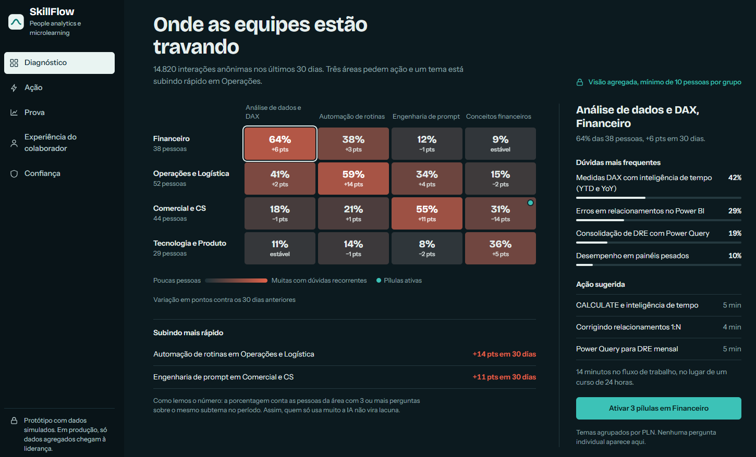
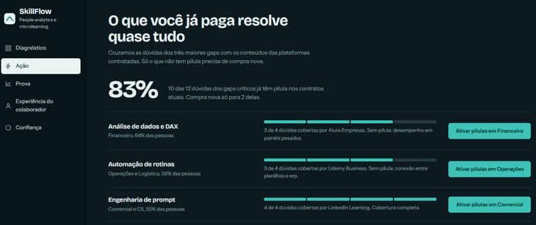
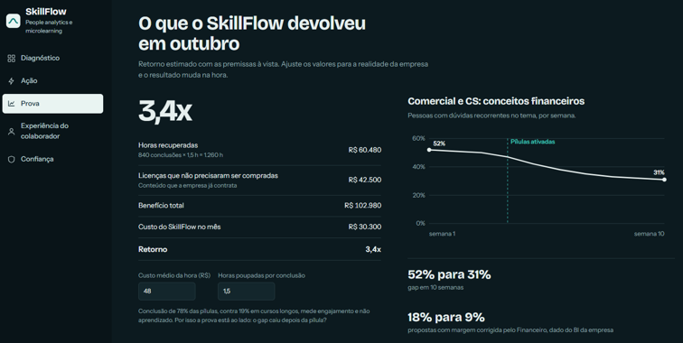
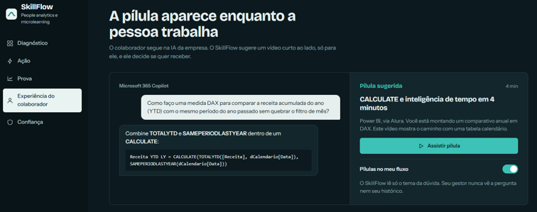
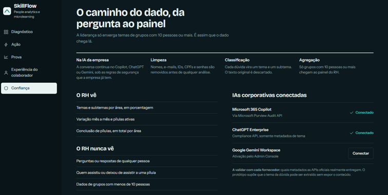

# 🚀 SkillFlow - People Analytics & Microlearning (FIAP Startup One)

**Visão Geral:** Uma plataforma SaaS de diagnóstico contínuo de competências que analisa, de forma anônima e agregada via API, as dúvidas cotidianas dos colaboradores em IAs corporativas — entregando visibilidade de *gaps* e comprovação de ROI para o RH, além de pílulas rápidas de aprendizado no fluxo de trabalho.

🌐 **Acesse o protótipo rodando ao vivo:** [Clique aqui para abrir](https://bruno-dacunha.github.io/skillflow-startup-one/)

---

## 🎯 O Desafio de Negócio (O Problema)

Empresas médias e grandes investem alto em plataformas de e-learning tradicionais, mas enfrentam baixa adesão e dificuldade para comprovar retorno prático. O desafio foi estruturar uma solução que conecte o trabalho diário à capacitação real, combatendo:

- 📉 **Baixo engajamento:** Cursos longos e genéricos desconectados da rotina prática das equipes.
- 💸 **Falta de comprovação de ROI:** Orçamento de T&D alocado sem dados objetivos sobre onde os times realmente travam.
- ⚠️ **Miopia na gestão de competências:** Dúvidas diárias feitas às IAs corporativas desperdiçadas como "ativos ociosos", sem gerar inteligência para capacitação.

---

## 💡 A Solução e Arquitetura do Produto

O **SkillFlow** foi estruturado em duas camadas complementares para gerar valor simultâneo para quem aprende e para quem gerencia o orçamento de T&D:

### 👤 Camada 1: Core da Experiência (Centrada no Colaborador)
- ⚡ **Just-in-Time Learning:** Entrega de pílulas práticas de 3 a 8 minutos diretamente ao lado da IA corporativa já utilizada pela empresa (Copilot, ChatGPT Enterprise ou Gemini).
- 🎛️ **Autonomia e Opt-out:** O colaborador decide se deseja manter as sugestões ativas no seu fluxo de trabalho.
- 🔒 **Privacidade Garantida:** O histórico individual nunca é exposto a gestores ou ao RH, eliminando o estigma de vigilância.

### ⚙️ Camada 2: Estratégia de Negócio (Centrada em RH, T&D e Liderança)
- 🗺️ **Diagnóstico Contínuo (Matriz de Calor):** Visão agregada por departamento e competência, destacando tendências emergentes nos últimos 30 dias.
- 🔄 **Reaproveitamento de Contratos:** Cruzamento automático dos *gaps* críticos com os catálogos de plataformas que a empresa já paga (Alura Empresas, Udemy Business, LinkedIn Learning).
- 📊 **Comprovação de ROI (Prova):** Calculadora transparente de retorno financeiro (horas recuperadas + licenças evitadas) combinada ao acompanhamento da queda real do *gap* após a ativação das pílulas.

---

## 🖥️ UX e Interface

A interface foi projetada com foco em clareza analítica, narrativa executiva (*Diagnóstico → Ação → Prova → Colaborador → Confiança*) e interatividade real no navegador.

| **Diagnóstico (Matriz de Calor)** | **Ação (Reaproveitamento de Contratos)** |
| :---: | :---: |
|  |  |
| **Prova (Calculadora de ROI e Evolução)** | **Experiência do Colaborador** |
|  |  |

| **Confiança (Governança LGPD e APIs)** |
| :---: |
|  |

---

## 🔒 Privacidade e Governança (LGPD by Design)

Para viabilizar a adoção corporativa e atender às exigências de TI, Segurança da Informação e LGPD, a arquitetura prevê um pipeline de 4 etapas:

- 🧹 **Limpeza na origem:** Remoção automática de nomes, e-mails, IDs, CPFs e dados sensíveis antes de qualquer processamento.
- 🏷️ **Classificação temática:** Conversão da dúvida em tema/subtema via PLN, com descarte do texto original.
- 👥 **Agregação mínima (k-anonimato):** Exibição no painel gerencial apenas para grupos com **10 ou mais colaboradores**, garantindo que o RH visualize tendências da área e nunca perguntas individuais.

---

## 🛠️ Tecnologias Utilizadas

- **Front-end (Protótipo Interativo):** HTML5, CSS3 (Grid, Custom Properties, Dark Mode nativo), JavaScript (Vanilla) e SVG.
- **Deploy:** GitHub Pages.
